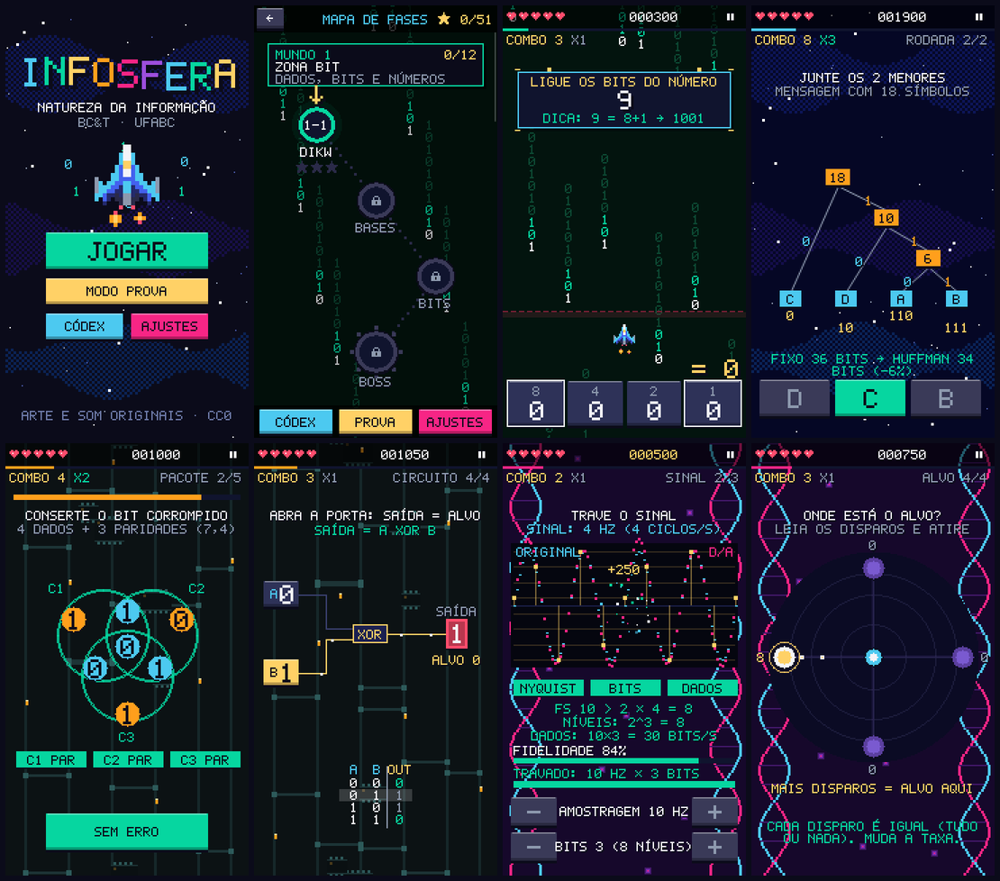

# INFOSFERA — Natureza da Informação (BC&T · UFABC)

Jogo mobile de ação, em pixel art, que ensina **na prática e em tempo real** o conteúdo de *Natureza da Informação*:
dado e informação, bits e bases numéricas, entropia, compressão (Huffman), canais e erros (paridade e Hamming),
lógica booleana, amostragem (Nyquist), DNA, neurônios e semiótica.
17 fases em 4 mundos, chefes, combo, estrelas, Modo Prova e um Códex de bolso.
O jogo é HTML5 (sem bibliotecas) e vira um APK pelo **GitHub Actions**, sem instalar nada no seu computador.



> **Aviso honesto.** É um material de estudo **não oficial**, feito a partir da ementa e dos planos de ensino da disciplina.
> O livro-base não pôde ser consultado durante a criação: confira os conceitos com a bibliografia oficial do seu professor
> (veja [docs/CURRICULO.md](docs/CURRICULO.md)). Os pixel arts e os sons são **originais, gerados em código** — veja [ASSETS.md](ASSETS.md).

---

## 1. Gerar o APK (3 passos)

1. **Crie um repositório no GitHub** (pode ser privado) e envie esta pasta inteira:
   ```bash
   git init && git add . && git commit -m "Infosfera"
   git branch -M main
   git remote add origin https://github.com/SEU-USUARIO/SEU-REPO.git
   git push -u origin main
   ```
2. Abra a aba **Actions**. O workflow **Build APK** começa sozinho a cada `push` (ou use *Run workflow*).
   Ele roda primeiro os testes da lógica (Node) e depois compila o app com Gradle.
3. Quando ficar verde, abra a execução e baixe, em **Artifacts**, o arquivo `infosfera-apk`.
   Dentro estão `infosfera-<versão>.apk` (release, **use este**) e `infosfera-<versão>-debug.apk`.
   No celular: copie o `.apk`, toque nele e permita *“instalar apps desconhecidos”* quando o Android pedir.

**Releases automáticas:** `git tag v1.0.0 && git push --tags` anexa os APKs à aba *Releases* do repositório.

**Assinatura.** Sem configurar nada, o APK é assinado com uma chave de **exemplo pública** (`app/keystore/ni-sample.jks`),
boa para testes (e, por ser sempre a mesma, uma versão nova instala por cima da anterior). Para publicar de verdade,
crie a sua chave e cadastre os *secrets* `ANDROID_KEYSTORE_BASE64`, `ANDROID_KEYSTORE_PASSWORD`, `ANDROID_KEY_ALIAS` e
`ANDROID_KEY_PASSWORD` (instruções em [app/keystore/LEIAME.txt](app/keystore/LEIAME.txt)). O workflow passa a usá-los automaticamente.

**Se o build falhar:** abra o passo vermelho na aba Actions e copie o erro — o projeto Android é pequeno (uma `Activity` com `WebView`,
sem dependências), então o problema costuma ser de ambiente e fácil de corrigir.

## 2. Jogar e desenvolver no computador

Não precisa de Node nem de Android Studio para jogar:

```bash
cd game && python3 -m http.server 8080      # abra http://localhost:8080 (use o modo celular do navegador)
```

Testes da lógica e dos geradores de perguntas (Node 18+):

```bash
node tools/test-logic.js     # bases, entropia, Huffman, Hamming, portas lógicas, Nyquist...
node tools/test-gen.js       # ~43 mil verificações: toda pergunta gerada tem gabarito, dica e formato válidos
```

Com Android Studio (opcional): abra a pasta, ele usa o `gradlew` incluído; `./gradlew assembleDebug` gera o APK em `app/build/outputs/apk/debug/`.
Dica para estudar: em **Ajustes → Modo estudo** todas as fases ficam liberadas.

## 3. Como se joga

Toda fase começa com uma **aula-relâmpago** (poucos cartões) e termina com uma **revisão** dos seus erros.
Dentro da fase o jogo segue o ritmo **TREINO** (com dicas) → **TESTE** (sem dicas) → **DESAFIO** (ação e ruído) → **ONDA FINAL**.

| Motor | Fases | Como jogar |
|---|---|---|
| **Terminal** | 1-1, 1-2, 2-2, 2-4, 3-1, 3-4, 4-2, 4-4, 4-5, Modo Prova | Pacotes de dados caem. Escolha a **arma-resposta** nos botões embaixo para destruir o pacote mais baixo antes que cruze o firewall; arraste a nave para desviar do ruído e pegar bônus. Nos chefes há padrões de tiro e fúria. |
| **Canhão de bits** | 1-3, 1-4 | Ligue e desligue os bits do registrador até o valor igualar o do cartão: o canhão dispara sozinho. |
| **20 Perguntas** | 2-1 | Corte a fila de blocos com perguntas sim/não — o melhor corte divide a probabilidade ao meio. |
| **Forja de Huffman** | 2-3 | Junte sempre os dois símbolos de menor frequência e leia os códigos da árvore. |
| **Hamming** | 3-2 | Os 3 círculos de paridade ficam vermelhos quando têm número ímpar de 1s: conserte o bit errado, codifique e meça distâncias. |
| **Portas lógicas** | 3-3 | Ligue as chaves de entrada até a saída igualar o alvo (AND, OR, NOT, XOR, NAND, NOR; meio somador e somador completo). |
| **Amostrador A/D** | 4-1 | Ajuste taxa de amostragem e bits para travar o sinal (Nyquist, quantização, aliasing). |
| **Neurônios** | 4-3 | Leia os disparos: quem dispara mais indica a direção, a taxa indica a distância. Arraste, mire e solte. |

Pontuação: acertos seguidos formam **combo** (multiplicador até ×5). **Estrelas:** ★ concluir, ★★ com ≥ 75% de acerto, ★★★ com ≥ 90%.
A dificuldade se adapta a você (acertou muito → acelera; errou → alivia). O **Modo Prova** mistura tópicos dos quatro mundos, sem dicas, e guarda o seu recorde.

## 4. Level design e sound design

Resumo (detalhes e como estender em [docs/DESIGN.md](docs/DESIGN.md)):

- **Ensinar–testar–complicar:** cada fase apresenta a regra com dicas, mede sem dicas e só então adiciona pressão (ruído, tempo, chefe).
- **Curva de dificuldade por mundo**, chefes em 3 estágios (fúria a 66% e “última fase” a 33% de vida), pausas de respiro entre as ondas com um resumo do conceito.
- **Feedback imediato:** erro mostra a dica e o gabarito na hora; acerto vira partículas, tremor de tela, vibração e som.
- **Música chiptune procedural em camadas:** um tema por mundo (escala, andamento e progressão próprios) e camadas (bateria, arpejo, melodia) que entram conforme a **intensidade** da ação; coração batendo quando o escudo está baixo.
- **Cada conceito tem o seu som:** cada bit tem um tom, cada porta lógica um tom próprio, cada amostra do conversor A/D estala no ritmo da taxa de amostragem, cada disparo de neurônio faz um *zap* e os acertos sobem de tom com o combo. Os efeitos são posicionais (pan estéreo pela posição na tela).

## 5. Estrutura do repositório

```
game/                  o jogo (HTML5/JS/CSS, vira assets do APK)
  js/                  engine, áudio, UI, geradores de perguntas, conteúdo pedagógico
  js/phases/           um arquivo por motor de fase (terminal, bitcannon, cut, huffman, hamming, logic, sampler, neural)
  assets/sprites/      (opcional) PNGs que substituem os sprites procedurais — veja ASSETS.md
app/                   projeto Android: MainActivity.java (WebView) + manifesto + ícones + chave de exemplo
tools/                 testes em Node e gerador de ícones (make-icons.py)
.github/workflows/     build-apk.yml — testes + APK (debug e release) + Release por tag
docs/                  CURRICULO.md (matéria × fases), DESIGN.md (level e sound design), imagens
```

O app Android é só uma casca: ele serve a pasta `game/` de dentro do APK para um `WebView` em tela cheia, retrato, **sem usar a internet**
(qualquer endereço externo é bloqueado), liga a vibração, trata o botão voltar e pausa a música quando você sai do app.

## 6. Limitações conhecidas

- **O APK não foi compilado no ambiente em que o projeto foi escrito** (sem Android SDK nem rede). O jogo foi testado de ponta a ponta em navegador
  (17 fases, bots com vários perfis de jogador) e o Java foi verificado contra stubs, mas **a primeira execução do workflow é o teste real** do empacotamento.
- Pixel art e áudio são originais e feitos em código (sem pacotes de terceiros), porque o ambiente não tinha acesso à internet para baixar assets.
  Se quiser arte de um pacote gratuito, é só soltar PNGs em `game/assets/sprites/` ([ASSETS.md](ASSETS.md)).
- Não testado em aparelhos reais: o toque, a vibração e o desempenho em celulares muito antigos podem precisar de ajustes finos.
- Conteúdo conferido com a ementa, não com o livro-base. Para a prova, use o jogo como treino — não como única fonte.

## 7. Leituras de apoio

Referências usadas como apoio para os conceitos (confira a lista oficial da disciplina no plano de ensino):

- SEIFE, C. *Decoding the Universe: How the New Science of Information Is Explaining Everything in the Cosmos, from Our Brains to Black Holes*. Viking, 2006.
- PIERCE, J. R. *An Introduction to Information Theory: Symbols, Signals and Noise*. 2. ed. Dover, 1980.
- FLOYD, T. L. *Digital Fundamentals* (em português: *Sistemas Digitais: Fundamentos e Aplicações*). Bookman.
- ROEDERER, J. G. *Information and Its Role in Nature*. Springer, 2005.
- EPSTEIN, I. *Teoria da Informação*. São Paulo: Ática, 1986.
- SHANNON, C. E. A Mathematical Theory of Communication. *Bell System Technical Journal*, 1948.

## 8. Licença

Código sob licença MIT ([LICENSE](LICENSE)). Pixel art, sons e ícones originais do projeto em **CC0** (domínio público).
